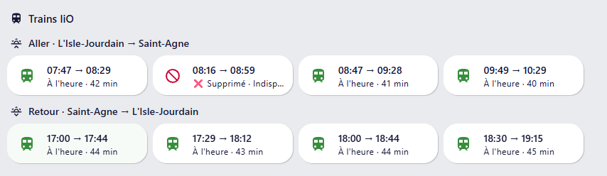

# 🚄 Intégration SNCF Trains pour Home Assistant


Suivez les horaires des trains SNCF entre deux gares dans Home Assistant, grâce à l’API officielle [SNCF](https://www.digital.sncf.com/startup/api).
Départ / arrivée, retards, durée, mode (TER…), tout est intégré dans une interface configurable et traduite.

> ✅ Ce fork détecte les **trains supprimés** (voir « Trains supprimés et perturbations » ci-dessous).

---

## 📦 Installation

### 1. Via HACS (recommandé)

> Nécessite HACS installé dans Home Assistant

1. Aller dans **HACS**
2. Chercher **SNCF Trains**
3. Installer puis redémarrer Home Assistant

### 2. Manuel (sans HACS)

1. Télécharger le contenu du dépôt
2. Copier le dossier `sncf_trains` dans `config/custom_components/`
3. Redémarrer Home Assistant

---

## ⚙️ Configuration

1. Aller dans **Paramètres → Appareils & services → Ajouter une intégration**
2. Rechercher **SNCF Trains**
3. Suivre les étapes :
   - Clé API SNCF
4. Ajouter un trajet :
   - Ville et gare de départ
   - Ville et gare d'arrivée
   - Plage horaire à surveiller

Plusieurs trajets peuvent être configurés séparément.

---

## 🧩 Options dynamiques

### Intégration principale (Configurer)

- ⏱ Intervalle de mise à jour **pendant** la plage horaire
- 🕰 Intervalle **hors** plage horaire

### Par trajet (Reconfigurer un trajet)

- 🚆 Nombre de trains affichés
- 🕗 Heures de début et fin de surveillance

✅ Aucun redémarrage requis. Les modifications sont appliquées dynamiquement.

---

## 🔐 Clé API SNCF

Obtenez votre clé ici : https://numerique.sncf.com/startup/api/

1. Créez un compte ou connectez-vous
2. Générez une clé API gratuite
3. Utilisez-la lors de la configuration (limite de 5 000 requêtes par jour)

> Pour changer de clé, cliquer sur **Reconfigurer** dans l'intégration.

---

## ⚙️ Variables de l'intégration

| Nom | Description |
|-----|-------------|
| `update_interval` | Intervalle de mise à jour **pendant** la plage horaire (défaut : 2 min) |
| `outside_interval` | Intervalle **hors** plage horaire (défaut : 60 min) |
| `train_count` | Nombre de trains à afficher |
| `time_start` / `time_end` | Plage horaire de surveillance (ex. : `06:00` → `09:00`). Seuls les trains **partant dans cette plage** (bornes incluses) sont affichés ; une plage peut traverser minuit (ex. `22:00` → `01:00`) |

> 🕑 L'intervalle actif s'active automatiquement **2h avant** le début de plage.

---

## 🚫 Trains supprimés et perturbations

En temps réel, l'API SNCF (Navitia) **retire** les trains supprimés de ses réponses au lieu de les signaler.
Cette version interroge donc aussi les **horaires théoriques** (`data_freshness=base_schedule`) et les compare au temps réel :

- un train prévu mais absent du temps réel (avant le dernier train temps réel renvoyé) est marqué **supprimé** ;
- une perturbation `NO_SERVICE` sur le train le marque aussi comme supprimé.
- un train qui **ne s'arrête plus à la gare d'arrivée** (arrêt supprimé par la SNCF) est aussi considéré comme supprimé.



_Exemple : le train de 08:16, masqué par l'API temps réel, est affiché comme supprimé avec le motif communiqué par la SNCF._

Nouveaux attributs sur chaque capteur de train :

| Attribut | Description |
|---|---|
| `status` | `on_time`, `delayed`, `departed` (déjà parti) ou `cancelled` — au tableau de bord de décider quoi afficher |
| `departed` | `true` si le train est déjà parti (heure de départ réelle passée) |
| `destination_served` | `false` si la SNCF a supprimé l'arrêt à la gare d'arrivée : le train est alors considéré comme supprimé |
| `cancelled` | `true` si le train est supprimé |
| `disruption_effect` | Effet de la perturbation la plus grave (`NO_SERVICE`, `SIGNIFICANT_DELAYS`…) |
| `disruption_message` | Explication : message de la perturbation, sinon cause indiquée sur le train, sinon message du trajet, sinon « Arrêt X supprimé » |

Le capteur « Tous les trains (ligne) » expose aussi `status` et `cancelled_count`, et le calendrier préfixe les trains supprimés par « ❌ Supprimé ».

Coût : un appel API supplémentaire par trajet et par mise à jour (l'appel théorique est « best effort » : s'il échoue, seules les données temps réel sont utilisées).

---

## 🔔 Événement par train : `sncf_trains_status_changed`

Les capteurs « Train 1…N » listent les **prochains départs** : ils se décalent quand un train part ou qu'une suppression s'insère. Pour réagir à un train **précis**, chaque train a un identifiant stable `train_uid` (numéro + date-heure prévue, ex. `870404_20261014T0816`) et l'intégration émet l'événement **`sncf_trains_status_changed`** quand son statut change :

- train vu pour la première fois en retard ou supprimé ;
- passage à l'heure / en retard / supprimé (dans un sens ou dans l'autre) ;
- évolution du retard d'un train déjà en retard.
- (le départ d'un train, statut `departed`, ne génère pas d'événement)

Le dernier statut de chaque train est mémorisé sur disque : pas de doublon après un redémarrage.

Données de l'événement : `train_uid`, `train_num`, `trip_title`, `departure_name`, `arrival_name`, `planned_departure`, `departure_time`, `arrival_time`, `status`, `previous_status`, `delay_minutes`, `disruption_effect`, `disruption_message`.

Exemple de notification :

```yaml
triggers:
  - trigger: event
    event_type: sncf_trains_status_changed
    event_data:
      status: cancelled
actions:
  - action: notify.mobile_app_mon_telephone
    data:
      title: "❌ Train supprimé"
      message: >-
        {{ trigger.event.data.departure_name }} → {{ trigger.event.data.arrival_name }}
        {{ as_timestamp(trigger.event.data.planned_departure) | timestamp_custom('%H:%M') }} :
        {{ trigger.event.data.disruption_message or 'supprimé' }}
```

Le nombre de capteurs « Train N » correspond toujours au nombre de trains demandé ; un créneau sans train reste vide.

---

## 📊 Capteurs créés

- `sensor.sncf_<gare_dep>_<gare_arr>` — capteur principal du trajet
- `sensor.sncf_train_X_<gare_dep>_<gare_arr>` — capteur par train
- `calendar.trains` — calendrier des prochains départs
- `sensor.sncf_tous_les_trains_ligne_X`

### Attributs du capteur principal

- Nombre de trajets
- Informations les inervalles

### Capteurs secondaires (enfants) pour chaque train

- Heure de départ (`device_class: timestamp`)
- Heure d’arrivée
- Retard estimé
- Durée totale (`duration_minutes`)
- Mode, direction, numéro

---

## 🎨 Carte Lovelace — SNCF Train Card

La carte `sncf-train-card` est **automatiquement disponible** dans le sélecteur de cartes dès l'installation de l'intégration.

### Ajouter la carte

Dans un tableau de bord, cliquer sur **+ Ajouter une carte** → chercher **SNCF Train Card**.

La configuration peut ensuite se faire :

- via l'éditeur visuel Lovelace
- ou via YAML

Ou en YAML :

```yaml
type: custom:sncf-train-card
device_id: VOTRE_DEVICE_ID
```

#### ✨ Support Multi-Devices

Vous pouvez afficher les trajets de **plusieurs appareils sur une seule carte**, avec un tri chronologique par date d'arrivée :

```yaml
type: custom:sncf-train-card
device_id:
  - DEVICE_ID_1
  - DEVICE_ID_2
  - DEVICE_ID_3
title: 'Tous Mes Trajets'
train_lines: 10
```

> **Rétrocompatibilité** : L'ancien format (`device_id: DEVICE_ID`) continue de fonctionner et est automatiquement converti en tableau.

### 🔍 Trouver le `device_id`

_S'obtient dynamiquement via la configuration visuelle._

Le `device_id` correspond à l'appareil créé lors de la configuration du trajet.

1. Aller dans **Paramètres → Appareils & services → SNCF Trains**
2. Cliquer sur le trajet souhaité
3. L'URL contient l'identifiant : `.../config/devices/device/XXXX`

> 

### ⚙️ Paramètres de la carte

| Paramètre | Type | Défaut | Description |
|-----------|------|--------|-------------|
| `device_id` | `string` \| `array[string]` | **obligatoire** | Identifiant(s) de l'appareil(s) SNCF. Peut être une chaîne unique ou un tableau de plusieurs IDs (voir ci-dessus) |
| `title` | `string` | `'Trains SNCF'` | Titre affiché en haut de la carte |
| `train_lines` | `number` | `3` | Nombre de trains affichés simultanément |
| `animation_duration` | `number` | `30` | Nombre de minutes avant l'arrivée en gare à partir duquel l'animation du train se déclenche (ex : `30` = animation active dans les 30 dernières minutes, `60` = dans la dernière heure) |
| `update_interval` | `number` | `30000` | Intervalle de rafraîchissement de la carte en **millisecondes** |
| `train_emoji_axial_symmetry` | `boolean` | `true` | Retourne l'emoji du train horizontalement |
| `train_emoji` | `string` | `'🚅'` | Emoji du train animé sur la barre |
| `show_departure_station` | `boolean` | `true` | Affiche ou masque les informations de départ |
| `departure_station_emoji` | `string` | `''` | Emoji de la station de départ |
| `show_arrival_station` | `boolean` | `true` | Affiche ou masque les informations d'arrivée |
| `arrival_station_emoji` | `string` | `'🚉'` | Emoji de la station d'arrivée |

### Exemples

**Single device :**
```yaml
type: custom:sncf-train-card
device_id: abc123def456
title: "Paris → Lyon"
train_lines: 4
train_emoji: "🚆"
train_emoji_axial_symmetry: true
show_departure_station: true
departure_station_emoji: "🚉"
show_arrival_station: true
arrival_station_emoji: "🏙️"
animation_duration: 0
update_interval: 60000
```

**Multiple devices (fusionnés et triés par date d'arrivée) :**
```yaml
type: custom:sncf-train-card
device_id:
  - abc123def456
  - def456ghi789
  - ghi789jkl123
title: "Tous Mes Trajets SNCF"
train_lines: 10
train_emoji: "🚄"
update_interval: 30000
```

### Exemple d'affichage


---

## 📸 Aperçus

**Carte capteur :**


**Détails du prochain train :**


**Dashboard Lovelace :**


---

## 🛠 Développement

Compatible avec Home Assistant `2025.8+`.

Structure :
- `__init__.py` : enregistrement de l'intégration et de la carte Lovelace
- `calendar.py` : calendrier
- `config_flow.py` : assistant UI de configuration
- `options_flow.py` : formulaire d’options dynamiques
- `sensor.py` : entités de capteurs
- `coordinator.py` : logique de récupération intelligente
- `translations/fr.json` : interface en français
- `manifest.json` : métadonnées et dépendances
- `www/sncf-train-card.js` : carte Lovelace personnalisée

---

## 👨‍💻 Auteur

Développé par [Master13011](https://github.com/Master13011)
Contributions bienvenues via **Pull Request** ou **Issues**

---

## 📄 Licence

Code open-source sous licence **MIT**
