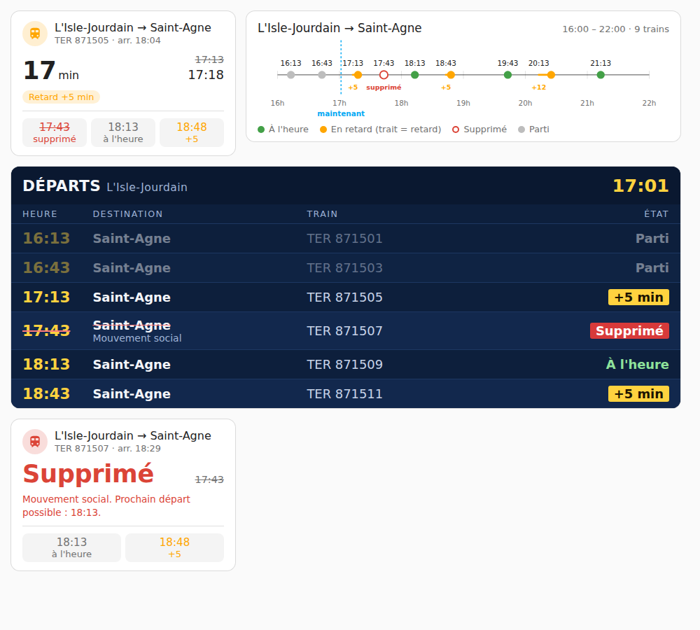

# 🚄 Intégration SNCF Trains pour Home Assistant


Suivez les horaires des trains SNCF entre deux gares dans Home Assistant, grâce à l’API officielle [SNCF](https://www.digital.sncf.com/startup/api).
Départ / arrivée, retards, durée, mode (TER…), tout est intégré dans une interface configurable et traduite.

> ✅ Ce fork détecte les **trains supprimés** (voir « Trains supprimés et perturbations » ci-dessous).

---

## 📦 Installation

### 1. Via HACS (recommandé)

> Nécessite HACS installé dans Home Assistant

1. Aller dans **HACS**
2. Chercher **SNCF Trains**
3. Installer puis redémarrer Home Assistant

### 2. Manuel (sans HACS)

1. Télécharger le contenu du dépôt
2. Copier le dossier `sncf_trains` dans `config/custom_components/`
3. Redémarrer Home Assistant

---

## ⚙️ Configuration

1. Aller dans **Paramètres → Appareils & services → Ajouter une intégration**
2. Rechercher **SNCF Trains**
3. Suivre les étapes :
   - Clé API SNCF
4. Ajouter un trajet :
   - Ville et gare de départ
   - Ville et gare d'arrivée
   - Heure de début, nombre de trains et, si besoin, heure de fin

Plusieurs trajets peuvent être configurés séparément.

---

## 🧩 Options dynamiques

### Intégration principale (Configurer)

- ⏱ Intervalle de mise à jour **pendant** la plage horaire
- 🕰 Intervalle **hors** plage horaire

### Par trajet (Reconfigurer un trajet)

- 🚆 Nombre de trains affichés
- 🕗 Heure de début et heure de fin (facultative)

✅ Aucun redémarrage requis. Les modifications sont appliquées dynamiquement.

---

## 🔐 Clé API SNCF

Obtenez votre clé ici : https://numerique.sncf.com/startup/api/

1. Créez un compte ou connectez-vous
2. Générez une clé API gratuite
3. Utilisez-la lors de la configuration (limite de 5 000 requêtes par jour)

> Pour changer de clé, cliquer sur **Reconfigurer** dans l'intégration.

---

## ⚙️ Variables de l'intégration

| Nom | Description |
|-----|-------------|
| `update_interval` | Intervalle de mise à jour **pendant** la plage horaire (défaut : 2 min) |
| `outside_interval` | Intervalle **hors** plage horaire (défaut : 60 min) |
| `time_start` | Heure de début de la plage (ex. : `06:00`) : premier départ affiché |
| `train_count` | Nombre **maximum** de trains affichés (1 à 10, obligatoire) |
| `time_end` | Heure de fin **facultative** (ex. : `09:00`). Seuls les trains **partant avant** cette heure (incluse) sont affichés ; une plage peut traverser minuit (ex. `22:00` → `01:00`) |

### 🕗 Plage horaire : heure de fin et nombre de trains

La plage commence à `time_start` et se termine à la **première limite atteinte** :

| Configuration | Trains affichés | Fin de la plage |
|---------------|-----------------|-----------------|
| `06:00`, 2 trains | Les 2 premiers trains après 6h | Départ du 2ᵉ train |
| `06:00` → `12:00`, 2 trains | Les 2 premiers trains entre 6h et 12h | Départ du 2ᵉ train, ou 12h s'il y en a moins de 2 |
| `06:00` → `07:00`, 5 trains | Les trains entre 6h et 7h (5 au plus) | 7h |

Une fois la plage terminée, l'intégration affiche les trains de la plage du lendemain.

> 🕑 L'intervalle actif s'active automatiquement **1h avant** le début de plage et dure jusqu'à la fin de la plage.

---

## 🚫 Trains supprimés et perturbations

En temps réel, l'API SNCF (Navitia) **retire** les trains supprimés de ses réponses au lieu de les signaler.
Cette version interroge donc aussi les **horaires théoriques** (`data_freshness=base_schedule`) et les compare au temps réel :

- un train prévu mais absent du temps réel (avant le dernier train temps réel renvoyé) est marqué **supprimé** ;
- une perturbation `NO_SERVICE` sur le train le marque aussi comme supprimé.
- un train qui **ne s'arrête plus à la gare d'arrivée** (arrêt supprimé par la SNCF) n'est **pas** marqué supprimé (il peut s'arrêter avant) : l'information est remontée via `destination_served: false` et l'événement.


_Exemple : le train de 08:16, masqué par l'API temps réel, est affiché comme supprimé avec le motif communiqué par la SNCF._

Nouveaux attributs sur chaque capteur de train :

| Attribut | Description |
|---|---|
| `status` | `on_time`, `delayed`, `departed` (déjà parti) ou `cancelled` — au tableau de bord de décider quoi afficher |
| `departed` | `true` si le train est déjà parti (heure de départ réelle passée) |
| `destination_served` | `false` si la SNCF a supprimé l'arrêt à la gare d'arrivée (le train circule mais ne vous y dépose pas) |
| `cancelled` | `true` si le train est supprimé |
| `departure_delay_minutes` / `arrival_delay_minutes` | Retard au départ / à l'arrivée ; `delay_minutes` vaut le plus grand des deux |
| `disruption_effect` | Effet de la perturbation la plus grave (`NO_SERVICE`, `SIGNIFICANT_DELAYS`…) |
| `disruption_message` | Explication : message de la perturbation, sinon cause indiquée sur le train, sinon message du trajet, sinon « Arrêt X supprimé » |

Le capteur « Tous les trains (ligne) » expose aussi `status` et `cancelled_count`, et le calendrier préfixe les trains supprimés par « ❌ Supprimé ».

Coût : un appel API supplémentaire par trajet et par mise à jour (l'appel théorique est « best effort » : s'il échoue, seules les données temps réel sont utilisées).

---

## 🔔 Événement par train : `sncf_trains_status_changed`

Les capteurs « Train 1…N » listent les **prochains départs** : ils se décalent quand un train part ou qu'une suppression s'insère. Pour réagir à un train **précis**, chaque train a un identifiant stable `train_uid` (numéro + date-heure prévue, ex. `870404_20261014T0816`) et l'intégration émet l'événement **`sncf_trains_status_changed`** quand son statut change :

- train vu pour la première fois en retard ou supprimé ;
- passage à l'heure / en retard / supprimé (dans un sens ou dans l'autre) ;
- évolution du retard d'un train déjà en retard.
- la gare d'arrivée n'est plus desservie (ou l'est de nouveau) : champ `destination_served`.
- (le départ d'un train, statut `departed`, ne génère pas d'événement)

Le dernier statut de chaque train est mémorisé sur disque : pas de doublon après un redémarrage.

Données de l'événement : `train_uid`, `train_num`, `trip_title`, `departure_name`, `arrival_name`, `planned_departure`, `departure_time`, `arrival_time`, `status`, `previous_status`, `delay_minutes`, `departure_delay_minutes`, `arrival_delay_minutes`, `destination_served`, `disruption_effect`, `disruption_message`.

Exemple de notification :

```yaml
triggers:
  - trigger: event
    event_type: sncf_trains_status_changed
    event_data:
      status: cancelled
actions:
  - action: notify.mobile_app_mon_telephone
    data:
      title: "❌ Train supprimé"
      message: >-
        {{ trigger.event.data.departure_name }} → {{ trigger.event.data.arrival_name }}
        {{ as_timestamp(trigger.event.data.planned_departure) | timestamp_custom('%H:%M') }} :
        {{ trigger.event.data.disruption_message or 'supprimé' }}
```

Le nombre de capteurs « Train N » correspond toujours au nombre de trains demandé ; un créneau sans train reste vide.

---

## 🛠️ Erreurs et réparations

Les problèmes persistants apparaissent dans **Paramètres → Réparations** (et disparaissent seuls une fois résolus) :

| Réparation | Quand | À faire |
|---|---|---|
| **Trajet SNCF invalide** | L'API refuse le trajet lui-même (gare inconnue, date hors horaires…) | Recréer le trajet en choisissant bien des gares |
| **API SNCF injoignable** | 3 mises à jour consécutives en échec | Vérifier la connexion ; les dernières données restent affichées |
| **Quota de l'API SNCF dépassé** | Clé limitée (5 000 requêtes/jour) épuisée | Moins de trajets ou intervalle plus long |

« Aucun train trouvé » n'est pas une erreur : la liste est simplement vide.

---

## 📊 Capteurs créés

- `sensor.sncf_<gare_dep>_<gare_arr>` — capteur principal du trajet
- `sensor.sncf_train_X_<gare_dep>_<gare_arr>` — capteur par train
- `calendar.trains` — calendrier des prochains départs
- `sensor.sncf_tous_les_trains_ligne_X`

### Attributs du capteur principal

- Nombre de trajets
- Informations les inervalles

### Capteurs secondaires (enfants) pour chaque train

- Heure de départ (`device_class: timestamp`)
- Heure d’arrivée
- Retard estimé
- Durée totale (`duration_minutes`)
- Mode, direction, numéro

---

## 🎨 Cartes Lovelace

L'intégration fournit **trois cartes**, chargées automatiquement : rien à installer en plus. Dans un tableau de bord, cliquer sur **+ Ajouter une carte**, chercher **SNCF** et choisir celle qui convient. L'éditeur visuel permet de choisir le ou les trajets à afficher.



| Carte | Type | Pour quoi faire |
|-------|------|-----------------|
| **Prochain train** | `custom:sncf-train-tile` | Savoir d'un coup d'œil s'il faut partir : compte à rebours, retard, trains suivants |
| **Tableau des départs** | `custom:sncf-departure-board` | Les prochains départs façon écran en gare, lisible de loin (tablette murale) |
| **Frise des départs** | `custom:sncf-train-timeline` | Les trains de la plage sur une ligne de temps : trous de desserte, ampleur des retards |

Un appui sur un train ouvre la fiche de son capteur. Les couleurs suivent le thème de Home Assistant (le tableau des départs garde ses couleurs de gare). Les textes sont en français ou en anglais selon la langue du profil.

### Paramètres

Communs aux trois cartes :

| Paramètre | Type | Défaut | Description |
|-----------|------|--------|-------------|
| `device_id` | `string` \| `array` | **obligatoire** | Trajet(s) à afficher (appareils de l'intégration). Plusieurs trajets sont fusionnés et triés par heure de départ |
| `title` | `string` | nom du trajet | Titre de la carte |

Propres à chaque carte :

| Carte | Paramètre | Défaut | Description |
|-------|-----------|--------|-------------|
| `sncf-train-tile` | `next_count` | `3` | Nombre de trains suivants affichés sous le prochain (0 à 5) |
| `sncf-departure-board` | `rows` | `6` | Nombre de lignes du tableau |
| `sncf-departure-board` | `show_departed` | `true` | Garde les trains partis (grisés) jusqu'à la fin de la plage |
| `sncf-train-timeline` | `start` / `end` | heures pleines autour des trains | Bornes de la frise (`HH:MM`) |

### Exemples

```yaml
type: custom:sncf-train-tile
device_id: abc123def456
next_count: 3
```

```yaml
type: custom:sncf-departure-board
device_id:
  - abc123def456
  - def456ghi789
title: Départs
rows: 8
```

```yaml
type: custom:sncf-train-timeline
device_id: abc123def456
start: "06:00"
end: "12:00"
```

### 🔍 Trouver le `device_id`

L'éditeur visuel le remplit pour vous. En YAML, le `device_id` est celui de l'appareil créé pour le trajet :

1. Aller dans **Paramètres → Appareils & services → SNCF Trains**
2. Cliquer sur le trajet souhaité
3. L'URL contient l'identifiant : `.../config/devices/device/XXXX`

> 

> L'ancienne carte `sncf-train-card` a été retirée en 2.0.0 : remplacez-la par l'une des trois cartes ci-dessus.

---

## 📸 Aperçus

**Carte capteur :**


**Détails du prochain train :**


**Cartes Lovelace :**


---

## 🛠 Développement

Compatible avec Home Assistant `2025.8+`.

Structure :
- `__init__.py` : enregistrement de l'intégration et de la carte Lovelace
- `calendar.py` : calendrier
- `config_flow.py` : assistant UI de configuration
- `sensor.py` : entités de capteurs
- `coordinator.py` : logique de récupération intelligente
- `translations/fr.json`, `translations/en.json` : interface en français et en anglais
- `manifest.json` : métadonnées et dépendances
- `www/sncf-trains-cards.js` : les trois cartes Lovelace (prochain train, tableau des départs, frise)

---

## 👨‍💻 Auteur

Développé par [Master13011](https://github.com/Master13011)
Contributions bienvenues via **Pull Request** ou **Issues**

---

## 📄 Licence

Code open-source sous licence **MIT**
